# TableMind

Full-stack, real-time QR ordering and dining management platform built with TanStack Start, React 19, Supabase (PostgreSQL), and Tailwind CSS.

[](https://github.com/Kansal26/Table_Mind/actions/workflows/ci.yml)
[](https://github.com/Kansal26/Table_Mind)
[](https://www.typescriptlang.org/)
[](https://react.dev/)
[](#license)

---

## Why This Exists

Traditional dine-in ordering suffers from severe operational bottlenecks: diners wait 10 to 15 minutes just to catch a waiter's attention, table orders get miscommunicated during peak rushes, and reconciling bills creates friction at checkout. At the same time, restaurant operators lack live visibility into table-level ordering patterns, kitchen prep bottlenecks, and customer dining preferences. TableMind eliminates these bottlenecks by turning any smartphone into an interactive, synchronized table portal. Diners scan a table QR code, browse a live dietary-aware menu, order via voice or tap on a shared cart, and complete payment directly through Razorpay, while staff track orders and kitchen load in real time.

---

## Key Features at a Glance

| Feature | What It Does | Status |
| :--- | :--- | :--- |
| **QR Table Sessions** | Resolves high-entropy Base64URL tokens to active tables without requiring account registration. | Implemented |
| **Shared Real-Time Cart** | Synchronizes item additions, quantities, and notes across all co-diners at the table. | Implemented |
| **Dietary & Allergen Filtering** | Labels common allergens, provides dietary pills, and warns before adding conflicting items. | Implemented |
| **Voice Ordering** | Converts natural speech to structured cart line items using speech recognition and LLM parsing. | Partial (Web Speech + LLM) |
| **Hybrid Recommendations** | Suggests dishes using diner history, item co-occurrence, diner ratings, and kitchen load. | Partial (Rules + LLM fallback) |
| **Dynamic Coupon Engine** | Evaluates minimum spend, customer eligibility, and time-of-day windows including overnight shifts. | Implemented |
| **Loyalty Wallet & Credits** | Awards points for completed orders and surveys; allows instant rupee redemption at checkout. | Implemented |
| **Razorpay Payments** | Creates server-side orders, verifies HMAC-SHA256 signatures, and executes atomic payment finalization. | Implemented |
| **Kitchen Load & Order Tracking** | Tracks live tickets through pending, preparing, served, and completed states. | Implemented |
| **Waiter & Service Dispatch** | Dispatches instant real-time assistance calls (water, waiter, bill) to the staff dashboard. | Implemented |
| **Analytics & CSV Exports** | Aggregates daily revenue, popular dishes, and feedback with downloadable CSV reports. | Implemented |
| **Two-Stage OTP Security** | Gates critical owner settings (passwords, deactivation, deletion) behind a 6-digit email OTP. | Implemented |

---

## Features in Depth

### 1. QR Sessions & Shared Table Cart
- **Experience:** Diners sit down, point their phone camera at the table QR code, and are immediately placed into the table's active dining session. Multiple diners at the same table join the same session. When Diner A adds a beverage or modifies a quantity, the change reflects on Diner B's screen instantly without a page reload.
- **Technical Approach:** The client resolves the Base64URL token against the database on page load and establishes a persistent Supabase Realtime channel scoped to the active table session. Carts are stored as active database records rather than local browser storage, allowing cross-device synchronization and persistence across browser refreshes.
- **Trade-off:** Operating a shared cart requires server-managed conflict resolution when two diners edit the same line item concurrently. We solve this by making line updates atomic in PostgreSQL.

### 2. Menu with Dietary & Allergen Awareness
- **Experience:** Diners can filter dishes by vegetarian, vegan, and gluten-free tags. Dishes display allergen badges (such as dairy, nuts, or shellfish). If a diner with a registered allergy profile attempts to add a conflicting dish, an acknowledgment modal prompts them before the item is placed into the cart.
- **Technical Approach:** Menu categories and item tags are indexed in PostgreSQL. When adding an item to the cart, the server checks the diner's stored profile against the dish's allergen array. If a match is found and no explicit override acknowledgment was passed, the mutation rejects the write and requests user confirmation.
- **Trade-off:** Strict allergen blocking can frustrate guests ordering for friends. Adding an explicit acknowledgment override balances diner safety with operational flexibility.

### 3. Voice Ordering
- **Experience:** Diners tap a microphone button and speak naturally (for example: *"Can we get two garlic naans and a butter chicken with extra butter?"*). The system transcribes the speech, identifies matching menu items and quantities, and presents a confirmation card to add them to the cart with one tap.
- **Technical Approach:** In-browser audio transcription is handled via the Web Speech API. The transcript is sent to a server function that invokes Groq (`llama-3.3-70b-versatile`) with a strict JSON output schema. The server cross-references the returned dish names against the restaurant's active menu catalog to ensure hallucinated dishes cannot be injected into the cart.
- **Trade-off:** Web Speech API availability is browser-dependent (strongest in Chromium and Safari). When speech recognition is unavailable, the UI cleanly hides the voice trigger in favor of manual selection.

### 4. Hybrid Recommendation Engine
- **Experience:** As diners view the menu, a curated "Recommended for You" carousel displays items tailored to their taste, such as frequent repeat dishes, pairings for items already in the cart, and top-rated specialties.
- **Technical Approach:** The recommendation pipeline operates in stages:
  1. **Hard Allergen Filtering:** Discards any dish conflicting with the diner's known allergies.
  2. **Diner Preference History:** Prioritizes dishes the diner has ordered frequently across past visits.
  3. **LLM Engine with Timeout:** For repeat diners, Groq generates contextual suggestions. A 3000ms timeout race ensures that if the LLM is slow, the engine falls back seamlessly to rule-based scoring.
  4. **Co-occurrence & Diner Ratings:** Analyzes past orders that contained the items currently in the cart to recommend frequently paired items, boosted by dishes with average ratings above 4.5 stars.
  5. **Kitchen Load Awareness:** Queries the current kitchen ticket load. If active prep load is high, dishes with prep times over 15 minutes are deprioritized, and fast-prep items are highlighted.
- **Trade-off:** Real-time pairing calculations across thousands of historical orders can increase query latency. We limit co-occurrence analysis to the 50 most recent matching orders to ensure sub-100ms response times.

### 5. Dynamic Coupon Engine
- **Experience:** At checkout, diners view available promotions (such as lunch specials or flat discounts) with real-time feedback on minimum spend thresholds and exact savings.
- **Technical Approach:** The server evaluates active coupon rules against the current cart. It enforces minimum order amounts, item exclusions, first-time customer constraints, and time-of-day windows. The engine handles overnight shifts (e.g. 22:00 to 02:00) by evaluating wrapping time intervals, and automatically pre-selects the coupon that yields the highest savings.
- **Trade-off:** Dynamic server-side evaluation requires recalculating cart totals on every coupon toggle, but it eliminates client-side coupon tampering.

### 6. Loyalty Points & Wallet
- **Experience:** Diners earn loyalty points upon completing paid meals and submitting post-order feedback. Accumulated points convert directly into rupee discounts during checkout.
- **Technical Approach:** Wallets are linked to authenticated customer profiles. Points conversions follow restaurant-defined ratios (e.g. 1 point = 1 rupee). Point deductions occur within an atomic database transaction alongside the payment finalization to prevent double-spending.
- **Trade-off:** Allowing anonymous guests to earn points creates orphaned balances. We allow guests to claim past orders into a new profile using order tokens within 30 days of dining.

### 7. Razorpay Payments with Server-Side Verification
- **Experience:** Diners review an itemized bill, tap "Pay Now", and complete payment via UPI, debit/credit cards, or net banking through the Razorpay checkout overlay. Once confirmed, an itemized tax receipt is generated and emailed.
- **Technical Approach:** The server calculates the authoritative bill amount in paise and initiates the order via Razorpay's API. Upon payment completion, the server validates the HMAC-SHA256 signature using the secret key and queries Razorpay's API to confirm the captured amount matches the database total. An atomic PostgreSQL stored procedure marks the order as paid, closes the dining session, and records loyalty deductions.
- **Trade-off:** Direct gateway API verification adds ~200ms to the payment callback, but it guarantees that forged client signatures or altered amounts are rejected before orders are marked paid.

### 8. Kitchen Order Tracking
- **Experience:** Kitchen staff and managers view incoming orders as organized ticket cards that advance through four operational stages: Pending, Preparing, Served, and Completed.
- **Technical Approach:** The dashboard subscribes to database changes over Supabase Realtime. When a diner pays or a waiter submits an order, the ticket pops up on the kitchen view with an audible alert. Status updates update the database immediately, keeping waitstaff informed of order progress.
- **Trade-off:** A web dashboard serves front-of-house managers well, but high-temperature, fast-paced kitchen lines ultimately benefit from dedicated tablet displays with physical ticket printer outputs.

### 9. Waiter Calls & Service Dispatch
- **Experience:** Diners can tap "Call Waiter", "Request Water", or "Request Bill" directly from their table screen.
- **Technical Approach:** Requests are inserted into a dedicated service calls table scoped to the table's active session and broadcast via Realtime to the dashboard. Calls include acknowledgment and resolution tracking so staff can mark requests attended.
- **Trade-off:** Unlimited service call buttons invite spam from unsupervised tables. Calls are rate-limited per session to prevent abuse.

### 10. Owner Dashboard, Analytics & CSV Export
- **Experience:** Restaurant owners track daily revenue, active table occupancy, average ticket size, and popular menu items. All historical data can be exported to CSV with one click for accounting and inventory audits.
- **Technical Approach:** Analytics queries aggregate order totals, tax breakdowns, and feedback scores over configurable time horizons (today, this week, this month). CSV generation runs in memory on the server with full escaping of comma and quote characters to prevent CSV injection vulnerabilities.
- **Trade-off:** Aggregating analytics live from production transaction tables is fast for single restaurants but requires dedicated reporting rollups at high scale.

### 11. Account Security with Two-Stage OTP Enforcement
- **Experience:** Restaurant owners can change operational settings directly. However, sensitive lifecycle actions (changing master passwords, deactivating restaurant operations, or deleting the account) require email OTP verification.
- **Technical Approach:** The owner initiates the action, triggering a 6-digit cryptographic OTP sent to their registered email address via Resend. The OTP has a 5-minute time-to-live and a hard limit of 3 verification attempts. Successful verification issues a short-lived single-use verification token required to authorize the final destructive API mutation.
- **Trade-off:** Multi-step verification adds an extra step to administrative tasks, but it prevents unauthorized takeovers from unattended terminals.

---

## Architecture Overview

TableMind follows a modern server-first single-page application model. TanStack Start handles server-side execution and client hydration, while Nitro provides a lightweight, platform-agnostic server runtime.

```
+-----------------------------------------------------------------------------------+
| Browser (React 19, TanStack Router, Web Speech API, Supabase Realtime Client)      |
+-----------------------------------------------------------------------------------+
                                         |
                                         | JSON over HTTP POST
                                         v
+-----------------------------------------------------------------------------------+
| TanStack Start Server Functions                                                   |
| - Zod Input Validation & Schema Parsing                                           |
| - PostgreSQL Sliding-Window Rate Limiting                                         |
| - Session Token & JWT Authorization Verification                                  |
| - Private Credentials Confinement (Service Role, Razorpay Secret, Groq Key)       |
+-----------------------------------------------------------------------------------+
        |                            |                           |
        | SQL / RPC (Service Role)   | HMAC / REST               | LLM Chat / REST
        v                            v                           v
+------------------+       +-------------------+       +--------------------+
| Supabase         |       | Razorpay          |       | Groq Cloud         |
| - PostgreSQL DB  |       | - Order Creation  |       | - Llama 3.3 70B    |
| - Auth (JWT)     |       | - Payment Capture |       | - Voice Parsing    |
| - Realtime Engine|       | - Verification    |       | - Recommendations  |
+------------------+       +-------------------+       +--------------------+
```

### Request Flow
1. **Client Call:** The browser triggers an RPC server function call. Public keys and UI state remain in the browser; sensitive logic never leaks to the client bundle.
2. **Server Middleware:** The server function parses incoming parameters against a strict Zod schema, checks client rate limits, and extracts authorization context.
3. **Internal Processing:** For administrative tasks, the user's Supabase Auth JWT is validated. For diner tasks, the table's `qrToken` is verified against active sessions.
4. **Data Mutations:** Mutations execute against PostgreSQL using a scoped service-role client, ensuring that database updates occur within verified business boundaries.
5. **Real-Time Push:** When table state or kitchen status changes, PostgreSQL triggers notify connected clients via Supabase Realtime WebSockets.

---

## Architectural Diagrams

### 1. System Architecture
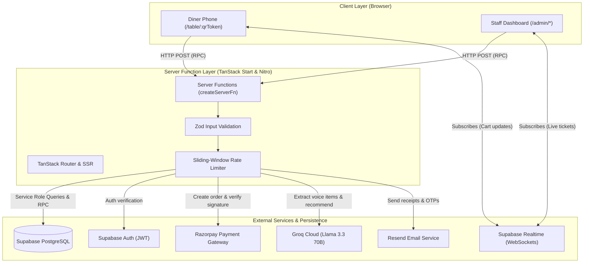
*Caption: System architecture displaying client communication with TanStack Start server functions, persistence in Supabase, and third-party integrations.*

---

### 2. Relational Data Model
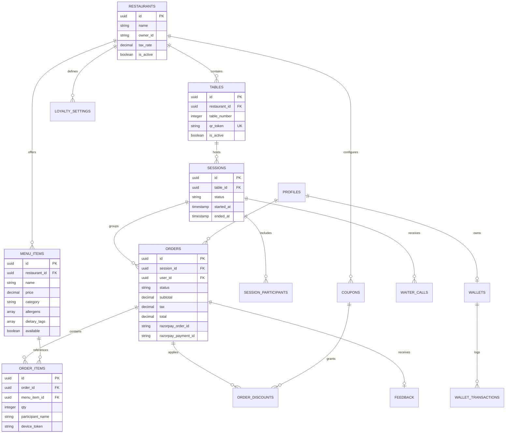
*Caption: Core database schema representing restaurant hierarchy, table sessions, order items, coupon applications, and loyalty balances.*

---

### 3. QR Scan & Table Session Join Flow
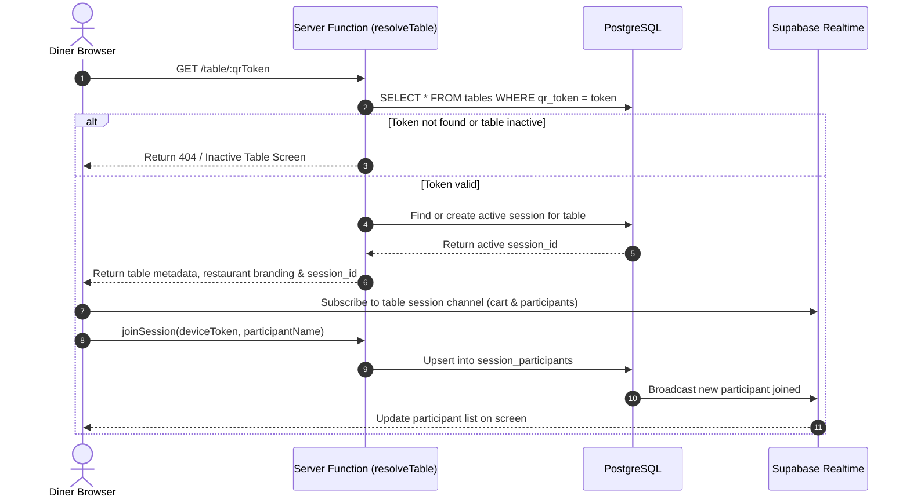
*Caption: Sequence diagram illustrating QR token resolution, active dining session binding, and real-time channel subscription.*

---

### 4. Checkout & Razorpay Payment Verification
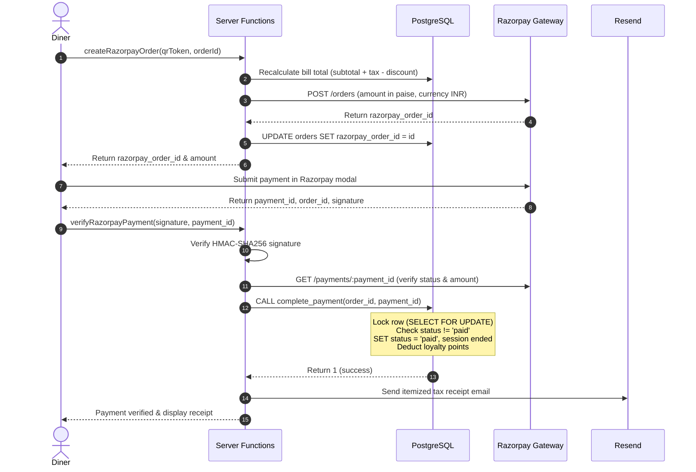
*Caption: Payment workflow detailing server-side order calculation, signature validation, atomic database finalization, and receipt dispatch.*

---

### 5. Voice Order Processing Pipeline
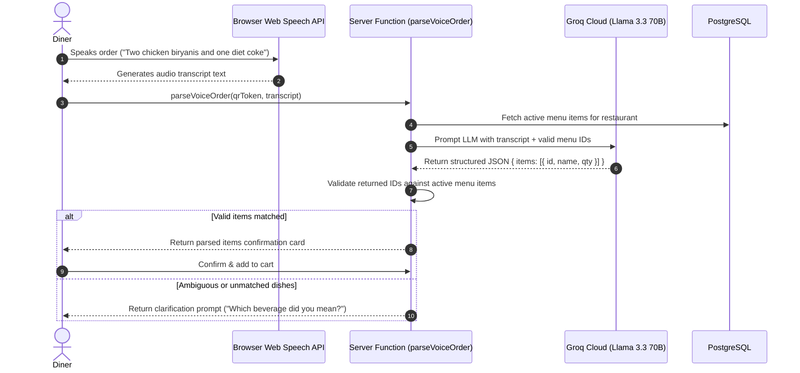
*Caption: Voice ordering sequence displaying speech-to-text conversion, server-side LLM parsing, catalog validation, and cart confirmation.*

---

### 6. Hybrid Recommendation Pipeline
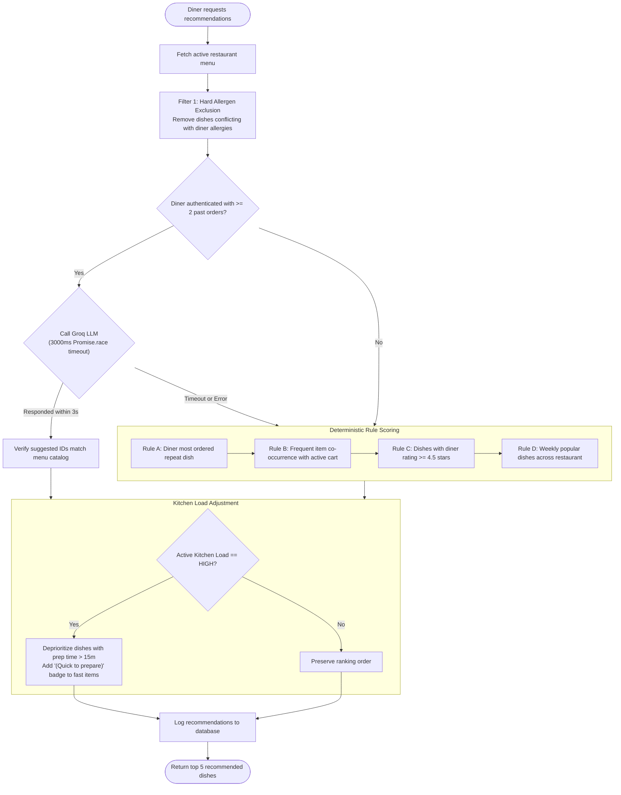
*Caption: Multi-stage recommendation pipeline illustrating hard allergen filtering, LLM execution with timeout fallback, rule scoring, and kitchen load adjustments.*

---

### 7. Coupon Evaluation & Best Discount Selection
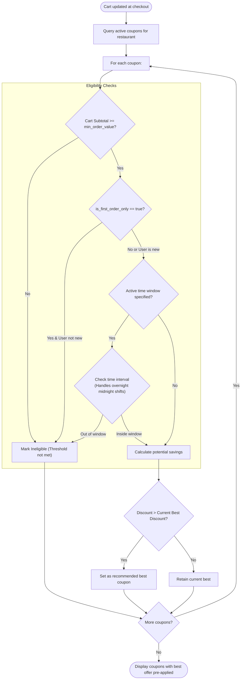
*Caption: Coupon evaluation algorithm showing minimum spend verification, customer status checks, overnight window parsing, and best-discount selection.*

---

### 8. Feedback to Loyalty Reward Loop
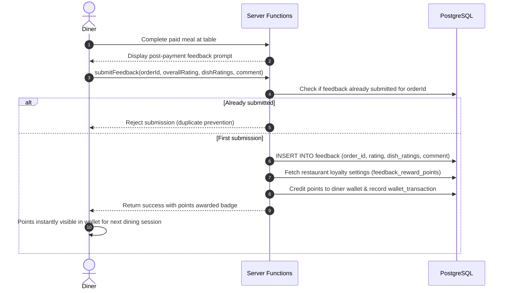
*Caption: Sequence diagram illustrating feedback collection, duplicate submission prevention, and automated loyalty reward crediting.*

---

### 9. Order & Session State Lifecycles
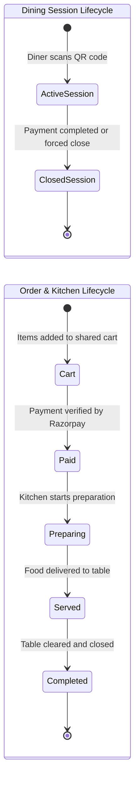
*Caption: State diagram showing the progression of dining sessions and the operational transitions of orders from cart creation to completion.*

---

### 10. Two-Stage OTP Account Security Flow
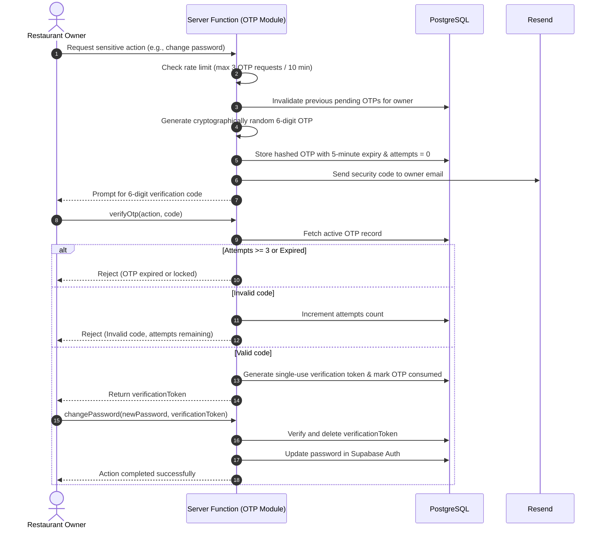
*Caption: Two-stage OTP verification sequence enforcing rate limits, attempt counters, and single-use verification tokens for sensitive account operations.*

---

### 11. Deployment Architecture
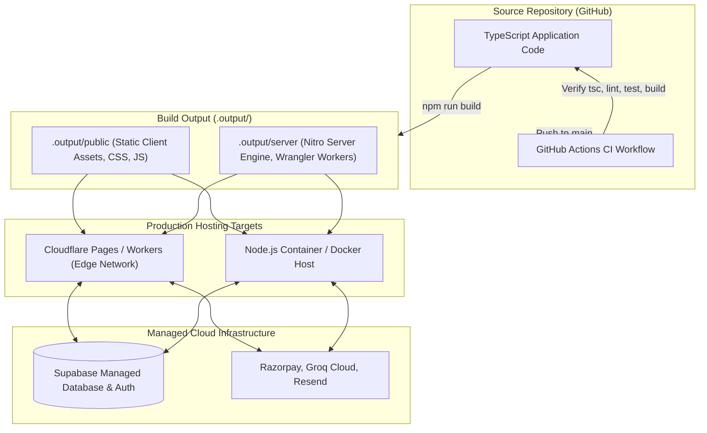
*Caption: Build artifact generation and multi-target deployment topology targeting Cloudflare Workers or standard Node.js containers.*

---

## Technology Stack

| Layer | Choice | Why Chosen |
| :--- | :--- | :--- |
| **Framework & Router** | TanStack Start + TanStack Router | Full-stack TypeScript framework with fully typed file-based routing and seamless server-to-client RPC boundaries. |
| **UI Library** | React 19 | Modern component model supporting server transitions, optimistic updates, and clean hook composition. |
| **Styling** | Tailwind CSS v4 | High-performance atomic styling with zero runtime CSS-in-JS overhead and native theme customization. |
| **Database & Auth** | Supabase (PostgreSQL 15) | Relational integrity, built-in connection pooling, Row Level Security, and native WebSocket Realtime channels. |
| **Payment Gateway** | Razorpay | Standard payment infrastructure for Indian dining operations supporting UPI, cards, and net banking with signature verification. |
| **AI Speech Parsing** | Groq (`llama-3.3-70b-versatile`) | Sub-second inference latency for real-time speech translation and contextual menu recommendations. |
| **Email Service** | Resend | Reliable transactional email delivery for itemized receipts and time-sensitive security OTPs. |
| **Testing** | Vitest | Extremely fast, native Vite-powered test runner sharing the same build transforms as production. |

---

## Security Model

Security in TableMind is implemented across multiple defensive layers:

1. **Row Level Security (RLS) & Column Grants:** Public database access via the client anonymous key is constrained by strict PostgreSQL policies. Diners can read published menus and restaurant metadata, but cannot read or mutate administrative tables, sensitive financial records, or owner credentials.
2. **Service-Role Confinement:** Direct service-role database access is restricted entirely to server functions and companion server modules. These modules are never included in the browser bundle.
3. **Tenant Isolation:** Administrative mutations query records scoped strictly to `restaurant_id = owner.restaurant_id`. Cross-tenant mutations return unauthorized errors.
4. **Input Validation:** Every server function verifies its payload using Zod. Requests containing malformed payloads, out-of-range quantities, or invalid types are rejected immediately.
5. **Database-Backed Rate Limiting:** High-frequency endpoints (voice parsing, table resolution, and payment creation) are metered using a PostgreSQL sliding-window table. IP and user client identifiers exceeding rate caps receive HTTP 429 responses.
6. **Payment Integrity:** Client-submitted bill totals are ignored. Authoritative prices are recomputed on the server, payment signatures are validated using HMAC-SHA256, and state transitions execute atomically via stored procedures.
7. **Two-Stage OTP Verification:** Destructive settings actions require a single-use verification token obtained by verifying a 6-digit email OTP within 5 minutes (max 3 attempts).

---

## Testing & Verification

The TableMind test suite verifies authorization rules, coupon calculations, payment race-condition handling, schema drift, and sensitive operations.

```bash
# Run the complete test suite
npx vitest --run

# Run TypeScript strict type verification
npx tsc --noEmit
```

### Verified Suite Metrics
- **Test Files:** 11 passed (100%)
- **Test Cases:** 64 passed (100%)
- **Type Errors:** 0 errors under TypeScript strict mode
- **Continuous Integration:** Automated on every push via GitHub Actions (`Typecheck, Lint, Test & Build`)

---

## Project Structure

```
table-mind/
├── .github/workflows/ci.yml       # GitHub Actions CI workflow (lint, typecheck, test, build)
├── docs/                          # Architectural documentation, API reference, and diagrams
│   ├── ARCHITECTURE.md            # In-depth system and concurrency documentation
│   ├── API.md                     # Complete server function catalog
│   ├── INTERVIEW_NOTES.md         # Technical decision notes and audit fixes
│   └── images/                    # Screenshot placeholders for walkthrough
├── src/
│   ├── components/                # Reusable UI components (voice order modal, cart, layout)
│   ├── integrations/supabase/     # Supabase client instances (browser and server) and database types
│   ├── lib/                       # Core business logic and server functions
│   │   ├── admin.functions.ts     # Owner dashboard and kitchen status functions
│   │   ├── coupons.server.ts      # Coupon evaluation engine
│   │   ├── ordering.functions.ts  # Cart mutations, recommendations, and Razorpay payments
│   │   ├── otp.server.ts          # Two-stage OTP verification module
│   │   └── voice.server.ts        # Groq speech parsing and menu validation
│   └── routes/                    # File-based routes (TanStack Router)
│       ├── __root.tsx             # Root layout with providers and toast notifications
│       ├── admin.dashboard.tsx    # Live kitchen cards and analytics dashboard
│       ├── admin.tables.tsx       # Table management and printable PDF export
│       ├── feedback.$orderId.tsx  # Post-payment dining survey
│       └── table.$qrToken.tsx     # Diner table portal and shared cart view
└── supabase/migrations/           # Ordered SQL migration scripts and stored procedures
```

---

## Getting Started

### Prerequisites
- Node.js 22+
- npm 10+
- A Supabase project (PostgreSQL)
- A Razorpay test account
- A Groq Cloud API key (for voice ordering and recommendations)
- A Resend account (for receipts and security OTPs)

### Setup Instructions

1. **Clone the repository:**
   ```bash
   git clone https://github.com/Kansal26/Table_Mind.git
   cd Table_Mind
   ```

2. **Install dependencies:**
   ```bash
   npm install
   ```

3. **Configure environment variables:**
   Copy `.env.example` to `.env` and fill in your credentials:
   ```bash
   cp .env.example .env
   ```

| Variable | Scope | Description |
| :--- | :--- | :--- |
| `VITE_SUPABASE_URL` | Public (Client & Server) | Supabase Project URL (`https://your-project.supabase.co`) |
| `VITE_SUPABASE_ANON_KEY` | Public (Client & Server) | Supabase anonymous public API key |
| `SUPABASE_SERVICE_ROLE_KEY`| Secret (Server Only) | Supabase service-role secret key |
| `VITE_RAZORPAY_KEY_ID` | Public (Client & Server) | Razorpay public Key ID (`rzp_test_...`) |
| `RAZORPAY_KEY_SECRET` | Secret (Server Only) | Razorpay secret API key |
| `GROQ_API_KEY` | Secret (Server Only) | Groq Cloud API key for voice parsing |
| `RESEND_API_KEY` | Secret (Server Only) | Resend API key for email delivery |
| `EMAIL_FROM` | Secret (Server Only) | Verified sender address (e.g. `orders@tablemind.com`) |

4. **Apply database migrations:**
   Run the migration scripts in the Supabase SQL editor in sequential order:
   ```
   1. supabase/migrations/20260803095246_72b11d27-7025-4d66-bc43-82dcab909be2.sql
   2. supabase/migrations/20260803100508_66dc81e7-aa23-4c81-aa6e-cedcc188b439.sql
   3. supabase/migrations/20260804110355_20b5934f-551c-425e-bcb0-6e54f0e59582.sql
   4. supabase/migrations/20260804110433_5202e632-8e6c-49e8-8359-35ccbeedeee1.sql
   5. supabase/migrations/20261016143600_security_lockdown.sql
   6. supabase/migrations/20261016150300_payments.sql
   7. supabase/migrations/20261016161500_otp_enforcement.sql
   8. supabase/migrations/20261016171500_baseline_schema.sql
   9. supabase/migrations/20261016174500_rate_limiting.sql
   10. supabase/migrations/20261016175000_restaurant_tax_rate.sql
   ```

5. **Start the development server:**
   ```bash
   npm run dev
   ```
   Open `http://localhost:5173` in your browser.

---

## Design Decisions & Trade-Offs

- **ADR 1: High-Entropy QR Tokens vs. Table Numbers**
  - *Decision:* Represent tables with random Base64URL tokens rather than sequential table IDs (`/table/1`).
  - *Why:* Prevents enumeration attacks where malicious actors tamper with carts or dispatch fake waiter calls from outside the restaurant.
  - *Consequence:* QR codes must be regenerated if a token is exposed.

- **ADR 2: Shared Cart per Table Session**
  - *Decision:* Maintain a single unified active cart per table session rather than individual diner carts.
  - *Why:* Mirrors real-world dining where parties share appetizers, review collective totals, and pay a single check.
  - *Consequence:* Requires real-time WebSocket broadcasting across all co-diners to prevent stale quantities.

- **ADR 3: Authoritative Server-Side Pricing**
  - *Decision:* Ignore client-calculated prices and recalculate totals on the server from database prices.
  - *Why:* Prevents browser DOM tampering where malicious clients attempt to submit discounted prices to the payment gateway.
  - *Consequence:* Additional database reads during checkout, mitigated by primary key lookups.

- **ADR 4: LLM Recommendations with Deterministic Fallback**
  - *Decision:* Wrap external LLM calls with a 3000ms timeout race falling back to rule-based scoring.
  - *Why:* External LLM APIs can experience latency spikes or rate limiting. Dining menus must load fast regardless of third-party availability.
  - *Consequence:* Diners receive fast recommendations even during third-party service outages.

- **ADR 5: PostgreSQL-Backed Sliding-Window Rate Limiting**
  - *Decision:* Use an indexed PostgreSQL table and cleanup function for rate limiting instead of introducing Redis.
  - *Why:* Keeps operational infrastructure minimal for single-cluster deployments without introducing a separate cache dependency.
- **ADR 6: Two-Stage Verification for High-Impact Operations**
  - *Decision:* Gate account deactivation, deletion, and password changes behind single-use verification tokens issued after 6-digit email OTP verification.
  - *Why:* Protects restaurant owner operations from catastrophic damage in the event of an unattended or hijacked session.
  - *Consequence:* Introduces a two-step administrative workflow for sensitive settings changes.

- **ADR 7: Service-Role Confinement to Server Functions**
  - *Decision:* Confine the Supabase service-role key exclusively to backend server functions and keep browser clients on public anon keys governed by Row Level Security.
  - *Why:* Prevents privilege escalation by ensuring that administrative permissions cannot be manipulated from browser memory or network tampering.
  - *Consequence:* All state mutations must route through server functions rather than direct client-to-database RPCs.

---

## Future Improvements

The following architectural enhancements are planned on the engineering roadmap:

- **Split-Bill Checkout:** Enabling individual diners within a shared table session to select and pay for only their specific ordered items while keeping the master table order in sync.
- **Dedicated Kitchen Display System (KDS):** A full-screen, high-contrast display view designed for kitchen line tablets, featuring ticket aging timers and audio chimes for incoming orders.
- **Thermal Printer Integration (ESC/POS):** Network printer support to automatically generate physical Kitchen Order Tickets (KOT) as soon as orders are paid.
- **Multi-Language Menu Localization:** Dynamic menu translation into regional languages (e.g. Hindi, Spanish, French) with localized currency formatting.
- **Transactional SMS Notifications:** Automated SMS alerts via Twilio or Fast2SMS alongside email receipts for diners who do not provide an email address.

---

## License

<!-- Placeholder: Specify license (e.g. MIT, Apache-2.0, or Proprietary) -->
This project is open-source. Please see the [LICENSE](LICENSE) file for exact terms once selected.

---

## Author

Developed by **[Aditya Kansal](https://github.com/Kansal26)**.
- GitHub: [@Kansal26](https://github.com/Kansal26)
- Repository: [Table_Mind](https://github.com/Kansal26/Table_Mind)
